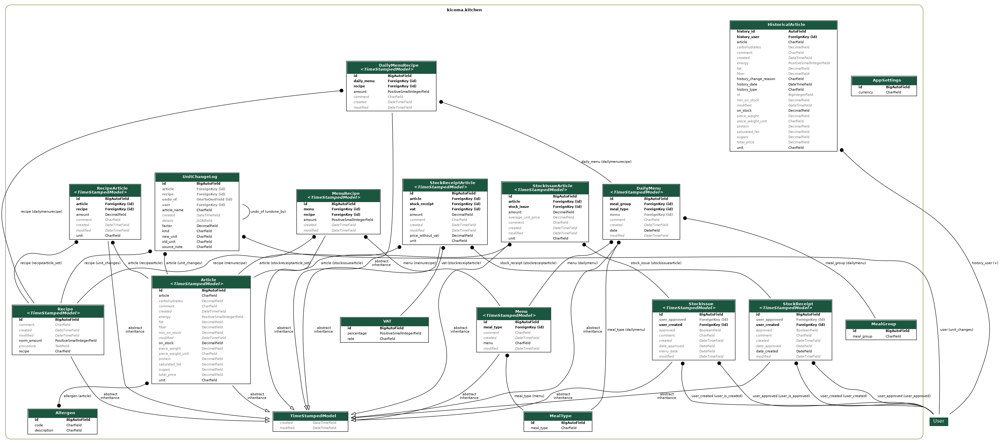

# KiCoMa - Kitchen cooking management

## Demo

The landing page runs at [kicoma.eu](https://kicoma.eu) and the public demo at [demo.kicoma.eu](https://demo.kicoma.eu)
(both served by the `demo` instance, see [Instances and tenants](#instances-and-tenants)).
Demo mode (`KICOMA_DEMO_MODE=True`) means:

- `./manage.py reset_demo` wipes **all** data and loads sample data from `kicoma/kitchen/fixtures` plus demo users,
  one per role and language: `kuchar`/`cook`, `skladnik`/`stockkeeper`, `nutricni-poradce`/`nutrition-advisor`,
  plus `spravce`/`admin` with the Správce/Admin role (not a Django superuser),
   password `KICOMA_DEMO_PASSWORD` (default `kicoma`). The login page lists the users for the current language.
  The command refuses to run when demo mode is off.
- Superadmin is created too when `KICOMA_DEMO_SUPERUSER_PASSWORD` is set. It is not listed on the login page; the password lives only in the git-ignored `config/secrets/demo/demo_superuser_password.key`.
- Sign-up, password/email changes and profile editing are blocked, a demo banner is shown and the login page lists the demo users.
- The landing page `/` is shown only in demo mode; on customer instances `/` redirects to `/kitchen/about`.

### Run the demo locally

`run-local.sh` uses a separate database file (`storage/demo.sqlite3`) so your development database stays untouched.
Stop the running server (Ctrl+C) and start the other one to switch:

```bash
./run-local.sh demo           # migrate, load demo data on first run, start the server
./run-local.sh demo --reset   # same, but start over with fresh demo data
./run-local.sh dev            # development database
```

The superadmin is created when `config/secrets/demo/demo_superuser_password.key` exists. Manual equivalent:

```bash
export DJANGO_SQLITE_PATH=storage/demo.sqlite3 KICOMA_DEMO_MODE=True
export KICOMA_DEMO_SUPERUSER_PASSWORD="$(cat config/secrets/demo/demo_superuser_password.key)"  # optional
./manage.py migrate
./manage.py reset_demo          # run again any time to start over
./manage.py runserver_plus 0.0.0.0:8000
unset DJANGO_SQLITE_PATH KICOMA_DEMO_MODE KICOMA_DEMO_SUPERUSER_PASSWORD   # back to the development database
```

### Run the demo remotely

The demo is a separate instance (`config/deploy.demo.yml`) with its own volume. It resets on every deploy
and nightly at 02:00 UTC via the `cron` role (supercronic, `config/crontab.demo`).

```bash
kamal deploy -d demo                            # deploy / upgrade
kamal app exec -d demo "./manage.py reset_demo" # reset now
kamal app logs -d demo -r cron                  # check the nightly reset
```

First deploy only - create its secrets and a DNS record (see [Add a new customer](#add-a-new-customer) step 2):

```bash
mkdir -p config/secrets/demo
python -c "import secrets; print(secrets.token_urlsafe(50))" > config/secrets/demo/django_secret.key
python -c "import secrets; print(secrets.token_urlsafe(12) + '/')" > config/secrets/demo/django_admin_url.key
printf '%s' '<superadmin password>' > config/secrets/demo/demo_superuser_password.key
```

Then fill in the Stripe Payment Links in `config/deploy.demo.yml` once they exist and deploy the demo again.

## License

All source code in this repository is released under the **[CC BY‑NC 4.0](https://creativecommons.org/licenses/by‑nc/4.0/)** license.

- ❌ **Commercial use is not permitted**
- 🔒 No patent rights are granted
- 📝 Attribution and copyright notice must be included
- ⚠️ No liability and no warranty

If you'd like to use this software commercially, please [contact me](https://www.stanislavvalasek.com/en/contact/) to discuss a commercial license.

## Data Model



## Regularly used commands

### Update static content

`./manage.py collectstatic --noinput`

### Update Translations

#### Generate message files for a desired language

`./manage.py makemessages -l en --ignore=.venv`
`./manage.py makemessages -l cs --ignore=.venv`

#### After adding translations to the .po files, compile the messages

`./manage.py compilemessages --ignore=.venv`

## Getting started

To get started with the app, clone the repo and then install Python 3:

```bash
cd ~/tmp
git clone https://github.com/valasek/kicoma
cd kicoma
```

### Start server locally

Just rebuild the dev container, app is running on port 8000

Alternativelly, install docker and docker compose and run `docker-compose up`

If you need to start server manually, the commnad is:
`./manage.py runserver_plus 0.0.0.0:8000`

## Instances and tenants

Every customer (tenant) gets its own container and its own SQLite volume on the same Hetzner server, deployed
as a [Kamal destination](https://kamal-deploy.org/docs/configuration/overview/#destinations). There is no shared
database, so data cannot leak between customers and deleting a customer means deleting its volume.

| File | Purpose |
| --- | --- |
| `config/deploy.yml` | Shared base (image, server, proxy, secrets list). Has no host or volume, so always deploy with `-d`. |
| `config/deploy.<name>.yml` | One per instance: `service`, `image`, `proxy.host`, `volumes`, `DJANGO_ALLOWED_HOSTS`, extra env. |
| `.kamal/secrets-common` | Secrets shared by all instances (registry, Mailgun). |
| `.kamal/secrets.<name>` | Per-instance secrets (`DJANGO_SECRET_KEY`, `DJANGO_ADMIN_URL`), read from `config/secrets/<name>/` (git-ignored, back it up). |

Current instances:

| Destination | Host | Volume | Notes |
| --- | --- | --- | --- |
| `demo` | kicoma.eu, www.kicoma.eu, demo.kicoma.eu | `kicoma_demo_storage` | Landing page and public demo, reset nightly |
| `hospic-cercany` | hospic-cercany.kicoma.eu | `kicoma_hospic_cercany_storage` | Pilot customer |

DNS: `A` records for `kicoma.eu` and `*.kicoma.eu` point to `162.55.185.37`, so new customers need no DNS change.

Rules:

- Never reuse a volume name between destinations - the volume *is* the customer's data.
- Never set `KICOMA_DEMO_MODE` on a customer instance - `reset_demo` would wipe it.
- Self sign-up is off (`DJANGO_ACCOUNT_ALLOW_REGISTRATION=False` by default); the customer's admin creates users.
- Roles are Django groups: `cook`, `stockkeeper`, `nutrition_advisor` and `admin` (Správce - all three roles plus
  data export and cleanup). Superadmin = Django superuser: additionally Django admin and full data import.
  Give the customer's admin the `admin` group; keep superuser for yourself.
- Application-admin JSON exports retain ordinary user credentials but replace every superuser password
   with `kicoma` in the exported file only. After restoring one, change all superuser passwords before
   exposing the instance publicly. Superuser exports retain the original passwords; protect all exports
   as sensitive backups.
- Docker build context excludes tenant keys, local environment files, Git history and downloaded backups.
   Previously committed credentials remain in Git history and may be present in older images; rotate
   exposed Django secret keys and Mailgun credentials, and replace old images/backups containing them.

### Deploy

Commit your changes, then:

```bash
export KAMAL_REGISTRY_PASSWORD=<value>
kamal deploy -d hospic-cercany    # one instance
./deploy-all.sh                   # build and deploy each config/deploy.*.yml
```

Kamal labels each image with its destination's service. Each destination uses a separate image
repository so tags for the same Git commit cannot overwrite another service's image. Docker reuses
cached build layers. Use `--skip-push` only after building and pushing for that same destination.

Migrations run automatically when a container starts (`entrypoint.sh`).

### Add a new customer

1. `./new-tenant.sh <slug> <host>`, e.g. `./new-tenant.sh domov-abc domov-abc.kicoma.eu`.
   It creates `config/deploy.<slug>.yml`, `.kamal/secrets.<slug>` and `config/secrets/<slug>/` and prints the next steps.
2. DNS: nothing to do for `*.kicoma.eu` (wildcard record). kamal-proxy gets the Let's Encrypt certificate on first deploy.
3. `kamal deploy -d <slug>`
4. Load basic data, create roles and the customer's admin:

   ```bash
   kamal app exec -d <slug> "./manage.py loaddata dph alergeny druhy-jidla skupiny-stravniku"
   kamal app exec -d <slug> "./manage.py shell -c \"from django.contrib.auth.models import Group; [Group.objects.get_or_create(name=n) for n in ('cook', 'stockkeeper', 'nutrition_advisor', 'admin')]\""
   kamal app exec -d <slug> --interactive "./manage.py createsuperuser"
   ```

5. Commit `config/deploy.<slug>.yml` and `.kamal/secrets.<slug>`; back up `config/secrets/<slug>/` outside git.

### Day-to-day work with an instance

```bash
kamal app logs -d <name>                                   # follow logs
kamal app exec -d <name> --interactive --reuse "bash"      # shell
kamal app exec -d <name> --interactive --reuse "./manage.py shell"
./fetch_remote_sqlite.sh <name>                            # download DB to sqlite_from_vps/<name>/
```

The download uses SQLite's online backup API against Django's configured database and checks its
integrity before replacing the local backup. It produces a standalone `kicoma.sqlite3` without WAL/SHM
files. Stop any local process using the previous downloaded database before fetching a replacement.

To import a downloaded DB locally: `DJANGO_SQLITE_PATH=sqlite_from_vps/<name>/kicoma.sqlite3 ./manage.py runserver_plus 0.0.0.0:8000`.

### Suspend or remove a customer

```bash
kamal app stop -d <slug>        # suspend (e.g. unpaid), data kept; `kamal app boot -d <slug>` to resume
./fetch_remote_sqlite.sh <slug> # final backup / export for the customer
kamal remove -d <slug>          # remove containers and proxy route
ssh root@162.55.185.37 docker volume rm kicoma_<slug_with_underscores>_storage   # delete data - irreversible
```

Then delete `config/deploy.<slug>.yml`, `.kamal/secrets.<slug>` and `config/secrets/<slug>/`.

### Copy a database into an instance

The instance must be stopped while its SQLite file is replaced; migrations run on the next boot.
Put the source files (`kicoma.sqlite3` and, if present, `-wal`/`-shm`) into `/root/kicoma-copy/` on the server.

```bash
kamal app stop -d <name>                                         # locally
ssh root@162.55.185.37 "docker run --rm -v /root/kicoma-copy:/from -v kicoma_<name_with_underscores>_storage:/to \
  debian:bookworm-slim sh -c 'rm -f /to/kicoma.sqlite3* && cp /from/kicoma.sqlite3* /to/'"
kamal app boot -d <name>                                         # locally
```

## Domain

Product domain is `kicoma.eu`. Host names live in `proxy.hosts` and `DJANGO_ALLOWED_HOSTS` of each
`config/deploy.<name>.yml`, and `KICOMA_DEMO_URL` in `config/deploy.demo.yml`.

## Server

Connect to server: `ssh root@162.55.185.37`

Free disk space if needed (without `--volumes` - that could delete the data of a customer whose container is removed)
docker system prune -af

## Upgrade packages

Run uv lock whenever you change pyproject.toml
uv sync --extra dev        # Install from lockfile

## Update all dependencies to latest compatible versions

Show outdated packages
uv tree --outdated --depth=1
uv lock --upgrade

## Generate lockfile without installing

uv lock
uv add new-package        # Adds to pyproject.toml and updates lockfile
uv remove old-package     # Removes from pyproject.toml and updates lockfile

## Update specific package

uv lock --upgrade-package django

## Update packages in specific group

uv lock --upgrade-package django --upgrade-package gunicorn

### When deploying for the first time, make sure these LOCAL ONLY config files exist

They are git-ignored (`config/secrets/` and `config/*.key`) - keep a backup outside git, e.g. in a password manager.

config/secrets/hospic-cercany/django_secret.key
e.g. `python -c "import secrets; print(secrets.token_urlsafe(50))" > config/secrets/hospic-cercany/django_secret.key`

config/secrets/hospic-cercany/django_admin_url.key to a random path ending with `/`, e.g. `admin-<random>/`
config/mailgun_api.key
config/mailgun_public.key
config/mailgun_smtp_login.key
config/mailgun_smtp_password.key

### Update Kamal and kamal proxy on localhost

```bash
gem update kamal
kamal proxy upgrade
```

### Path to sqlite

`/var/lib/docker/volumes/<volume>/_data/`, e.g. `kicoma_hospic_cercany_storage` for the hospice, `kicoma_demo_storage` for the demo.

### Sqlite backups to S3

Check if litestream is running:

`sudo journalctl -u litestream -f`

## Usefull Commands

### Run bash inside cosker container

`docker exec -it kicoma-web-1 bash`

### Reset Development DB

`./reset-db.sh`

### Recover Local Superuser Access

If the superuser already exists, reset its password instead of deleting and
recreating it. Deleting a user can also delete related application data.

```bash
uv run python manage.py changepassword valasek
```

To list the available superuser usernames:

```bash
uv run python manage.py shell -c "from django.contrib.auth import get_user_model; print(list(get_user_model().objects.filter(is_superuser=True).values_list('username', flat=True)))"
```

Create a superuser only when the database does not contain one:

```bash
uv run python manage.py createsuperuser
```

Importing the production database also imports its users and password hashes.
After the import, reset the imported superuser's password locally with
`changepassword` as shown above.

### Generate user password for fixture

```bash
./manage.py shell
from django.contrib.auth.hashers import make_password
make_password('password')
```

### Generate DB model

Using [Graph models](https://django-extensions.readthedocs.io/en/latest/graph_models.html)

`./manage.py graph_models -a -g -o datamodel.png` or

`./manage.py graph_models kitchen -g -o datamodel.png` and copy the file to statics/images

### Type checks

Running type checks with mypy:

`uv run mypy kicoma config`

### Test coverage

To run the tests, check your test coverage, and generate an HTML coverage report::

```bash
coverage run -m pytest
coverage html
open htmlcov/index.html
```

### Running tests

Add dev dependencies into console and run tests

`uv run python manage.py test --settings=config.settings.test`

### Check the production settings

`uv run python manage.py check --deploy --settings=config.settings.production`

## Import data from local machine into it into docker on Hetzner

**Get container ID**:

```bash
scp ./full_dump.json root@162.55.185.37:/root/full_dump.json
ssh root@162.55.185.37
CONTAINER_ID=$(docker ps --format '{{.ID}}' --filter 'name=kicoma-web-' --filter 'ancestor=svalasek/kicoma')
docker cp /root/full_dump.json $CONTAINER_ID:/app/full_dump.json
docker exec -it $CONTAINER_ID python3 manage.py flush --noinput
docker exec -it $CONTAINER_ID python3 manage.py loaddata full_dump.json
```

## Additional info for local development and Cookiecutter info

Check the original repo template:
[Developing locally](https://cookiecutter-django.readthedocs.io/en/latest/developing-locally.html)

### Settings

[Settings](http://cookiecutter-django.readthedocs.io/en/latest/settings.html)

### Live reloading and Sass CSS compilation

[Live reloading and SASS compilation](http://cookiecutter-django.readthedocs.io/en/latest/live-reloading-and-sass-compilation.html)

# ToDo

Stripe:
create the Payment Links, then fill in KICOMA_PAYMENT_LINK_MONTHLY and KICOMA_PAYMENT_LINK_YEARLY in the hospice config.

